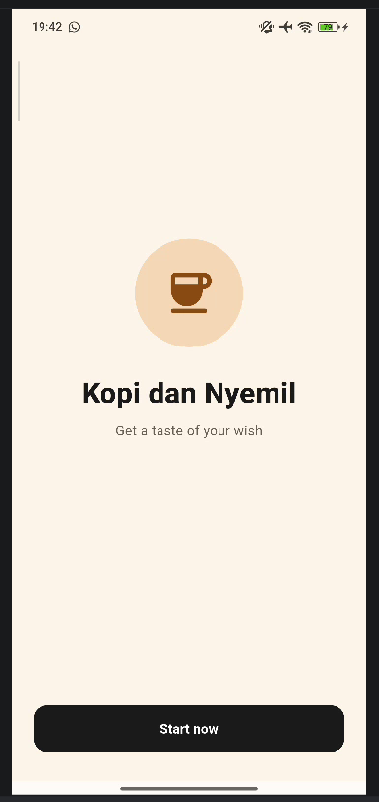
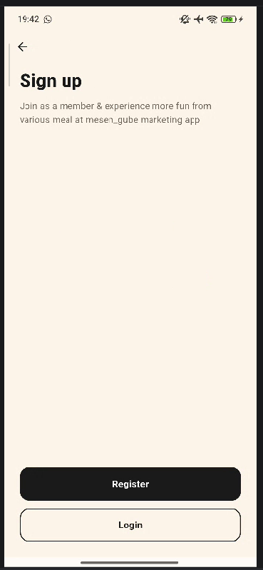
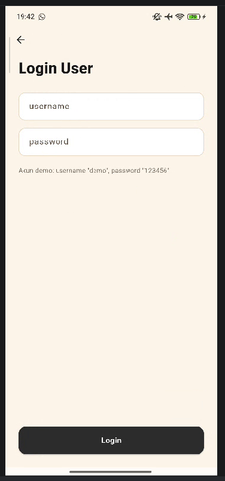
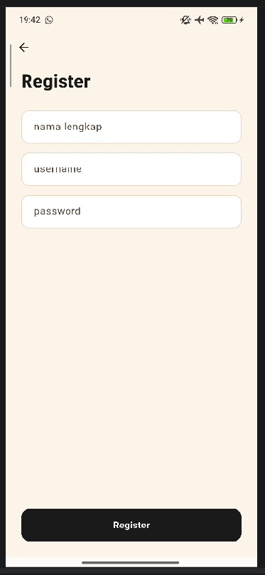
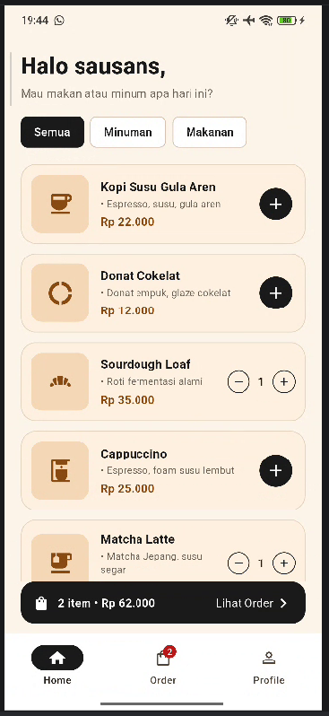
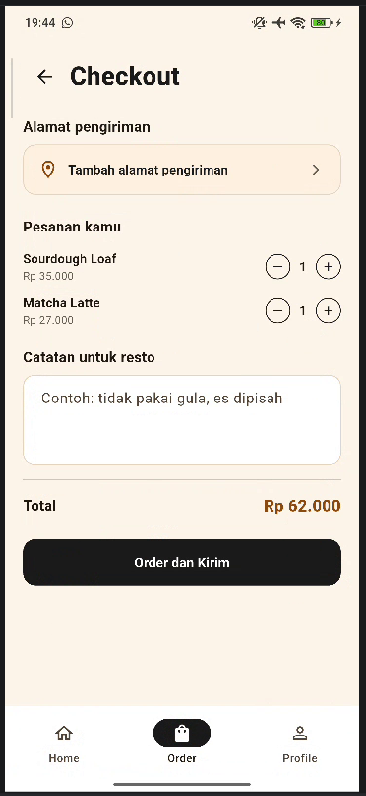
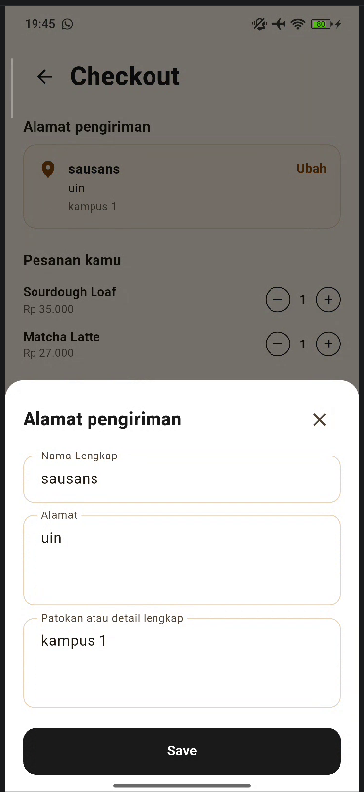
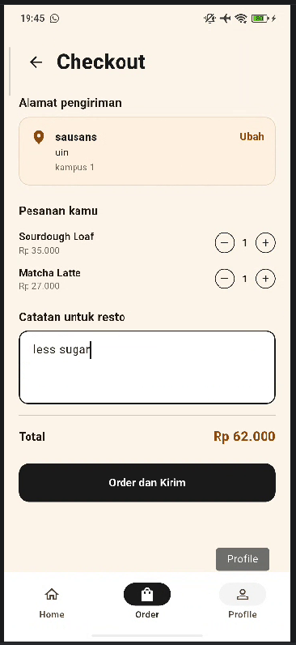
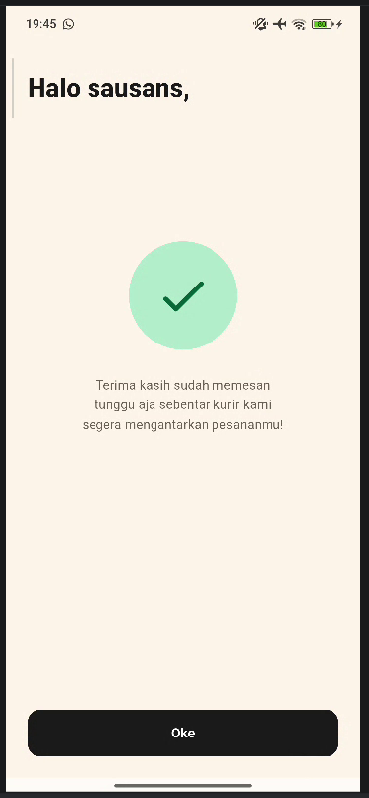
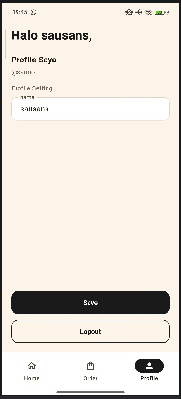

# Kopi dan Nyemil

Aplikasi mobile pemesanan kopi dan camilan, dibuat untuk tugas **UTS Pemrograman Mobile**. Aplikasi dibangun dengan Flutter berdasarkan wireframe "Kopi dan Nyemil" dari dosen. Seluruh data bersifat statis (dummy) dan disimpan di memori aplikasi, tanpa database.

## Deskripsi

Pengguna membuka aplikasi lewat halaman welcome, lalu mendaftar atau login. Di Home, pengguna memilih makanan dan minuman, lalu menuju halaman Checkout untuk mengisi alamat pengiriman dan catatan untuk resto. Setelah pesanan dikirim, pengguna menerima halaman konfirmasi. Nama pengguna juga dapat diubah di halaman Profile.

## Fitur

- **Splash / Welcome**: logo, nama aplikasi, tagline, dan tombol *Start now*.
- **Sign up**: pilihan *Register* atau *Login*.
- **Register**: nama lengkap, username, dan password, dengan validasi form serta pengecekan username yang sudah dipakai.
- **Login**: validasi username dan password terhadap akun yang terdaftar.
- **Home**: sapaan "Halo {nama}", daftar 8 menu makanan dan minuman, filter kategori (Semua, Minuman, Makanan), tombol tambah (+) dan pengatur jumlah, serta bar ringkasan keranjang.
- **Checkout (Order)**:
    - tombol kembali ke Home di kiri atas,
    - kotak alamat pengiriman yang dapat ditekan, dengan form alamat (nama lengkap, alamat, patokan) dalam bentuk bottom sheet dan tombol *Save*,
    - ringkasan pesanan dengan pengatur jumlah dan total harga,
    - kolom catatan untuk resto di bawah daftar menu,
    - tombol *Order dan Kirim* yang menolak pesanan jika keranjang atau alamat masih kosong.
- **Konfirmasi pesanan**: pesan terima kasih dan tombol *Oke* untuk kembali ke Home.
- **Profile**: ubah nama lalu *Save* (sapaan di seluruh aplikasi ikut berubah) dan tombol *Logout*.
- **Bottom navigation**: Home, Order (dengan badge jumlah item di keranjang), dan Profile.

**Akun demo:** username `demo`, password `123456`. Pengguna juga bisa membuat akun baru lewat halaman Register.

## Alur Aplikasi

~~~text
Splash -> Sign up -> Login / Register -> Home <-> Checkout -> Konfirmasi -> Home
                                           \-> Profile
~~~

## Teknologi

- Flutter dan Dart (Material 3)
- State management: `ChangeNotifier` dan `ListenableBuilder` (bawaan Flutter, tanpa package tambahan)
- Data dummy statis di `lib/models.dart` (tanpa database)
- IDE: Android Studio

## Struktur Folder

~~~text
lib/
├── main.dart
├── theme.dart            # warna dan tema
├── models.dart           # model data, data dummy menu, format rupiah
├── app_state.dart        # akun, keranjang, alamat, catatan, tab aktif
├── widgets/
│   └── common.dart       # tombol, kolom isian, helper snackbar
└── screens/
    ├── splash_screen.dart
    ├── signup_screen.dart
    ├── login_screen.dart
    ├── register_screen.dart
    ├── main_shell.dart       # bottom navigation
    ├── home_screen.dart
    ├── address_screen.dart   # halaman Checkout
    ├── confirmation_screen.dart
    └── profile_screen.dart
~~~

## Cara Menjalankan

Prasyarat: [Flutter SDK](https://docs.flutter.dev/get-started/install) terpasang, serta emulator atau HP Android yang tersambung (cek dengan `flutter doctor`).

~~~bash
git clone https://github.com/sausansyakiraa/kopi_dan_nyemil.git
cd kopi_dan_nyemil
flutter pub get
flutter run
~~~

Atau buka folder project di Android Studio, pilih perangkat di toolbar, lalu klik tombol Run.

## Screenshot

| Splash | Sign up | Login | Register | Home |
|---|---|---|---|---|
|  |  |  |  |  |

| Checkout | Form Alamat | Checkout (alamat terisi) | Konfirmasi | Profile |
|---|---|---|---|---|
|  |  |  |  |  |

## Pembuat

- Nama: Sausan Syakira Rihadatulaisy
- NIM: 1247050055
- Mata kuliah: Pemrograman Mobile (UTS)